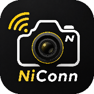

<p align="center">
  
</p>

# NiConn_DEMO

[中文](README.md) | **English**

An Android demo app for wireless control of the Nikon Z50II.

It uses the camera's "Connect to Smart Device" menu in STA mode (the camera joins the phone's hotspot) and speaks the PTP/IP wireless protocol to perform discovery, pairing, connection, live view, parameter adjustment and gallery management. 

## Features

- **Connection wizard**: three-step guide (phone hotspot → camera STA pairing → discover & connect), automatic pairing-code confirmation, last-camera memory with quick reconnect
- **Settings drawer**: tap the "NiConn" title on the connection page to slide it in from the left (iOS style); configurable live view frame rate (battery saver / balanced / smooth), default landscape, keep screen on, gallery thumbnail columns; diagnostics section to export/clear app logs; "About" shows version info and **Check for Updates**
- **Check for Updates**: one tap compares against the latest GitHub Release and jumps to the release page when a newer version exists; reads the repository web endpoint instead of the GitHub API to avoid API rate limits triggered by shared egress IPs on mobile networks
- **Live view**: ~10fps wireless viewfinder; tap-to-focus (single-point AF area mode + green focus box); shutter release; ISO / shutter speed / aperture / exposure compensation / white balance adjusted to the values the camera actually supports; landscape mode
- **Gallery**: thumbnail grid (JPEG/NEF badges, scroll-ahead prefetch), full-screen viewer (thumbnail shown instantly, quick preview within a second, original image seamlessly replaces it at full sharpness; EXIF auto-rotation, pinch zoom around the fingers, pan clamped to image bounds, double-tap to reset), photo details (filename, size, resolution, ISO, shutter, aperture, focal length, capture date), delete, long-press multi-select batch download
- **Photo watermark**: two layouts whose designs are adapted from the open-source project [photix-mark-web](https://github.com/LeoonLiang/photix-mark-web) (see [Acknowledgements](#acknowledgements))
  - **Classic layout**: bottom watermark bar with four-corner composition — top-left "brand + model" (brand deduplicated when the model name already includes it), bottom-left lens (falls back to `Unknown Lens` when missing), top-right focal length / aperture / shutter / ISO, bottom-right capture time, brand logo image on the far right
  - **Artistic layout**: blurred background fill + rounded, shadowed main image (centered, slightly above middle) + camera and shooting parameters as text at the bottom
  - Every element (model / lens / focal length / aperture / shutter / ISO / time) can be toggled individually, shared by both layouts
  - Image picker filters by **JPG / NEF**; NEF files render via their embedded JPEG preview; results are saved to an app-private directory with a one-tap shortcut to open the folder

## Tech Stack

- Kotlin + Jetpack Compose (Material3)
- Coroutines (Coroutines / Flow)
- PTP/IP over Wi-Fi: mDNS (`_ptp._tcp`) discovery + TCP 15740 proprietary framing
- Unit tests: JUnit4 + mock camera server
- minSdk 26 (Android 8.0+) / targetSdk 36

Protocol details (frame format, pairing code, live view, gallery commands, etc.) are documented in [docs/PROTOCOL.en.md](docs/PROTOCOL.en.md).

## Prebuilt APK

- File: [release/NiConn_Demo-v0.1.4.apk](release/NiConn_Demo-v0.1.4.apk)
- Version: **v0.1.4** (versionCode 5, debug signed)
- Build date: 2026-10-25
- Unit tests: 103 test cases, all passing
- ⚠️ This version is a **not fully verified** pre-release of performance and interaction optimizations; keep the previous package around for rollback
- Install: allow "Install unknown apps", or `adb install -r release/NiConn_Demo-v0.1.4.apk`

See [Releases](https://github.com/Debugzzz/NiConn_DEMO/releases) for previous versions.

## Building

Requirements: JDK 17+, Android SDK (compileSdk 36), Android Studio or command-line Gradle.

```bash
./gradlew :app:assembleDebug
# Output: app/build/outputs/apk/debug/app-debug.apk (file name = module name app + build type debug)
```

Running `./gradlew :app:assembleRelease` produces `app-release.apk` (debug-signed when no signing config is set). The demo package shipped in this repo was renamed to `NiConn_Demo-v0.1.3.apk`.

Install on a phone:

```bash
adb install -r app/build/outputs/apk/debug/app-debug.apk
```

Run the unit tests:

```bash
./gradlew :app:testDebugUnitTest
```

## Getting Started

1. Enable the phone's mobile hotspot (avoid non-ASCII SSID names).
2. Camera: network menu → Connect to Smart Device → Wi-Fi connect (STA mode) → create a profile and join the hotspot, then stay on the pairing screen.
3. App: tap "Start Discovery" → select the camera → after pairing succeeds press OK on the camera → tap "Reconnect".
4. Once connected, open "Live View" or "Gallery".

## Compatibility

- Verified: Nikon Z50II (firmware C 1.02), Xiaomi 15 (HyperOS 3.0.303.0)
- In theory compatible with other Expeed 7 generation bodies; not individually verified

## Known Limitations

- **Live view tap-to-focus coordinates**: on the Z50II the tapped position still does not fully map to the camera's actual focus point; further calibration development is needed, and other bodies will need recalibration as well.

Development status and plans are tracked in [docs/ROADMAP.md](docs/ROADMAP.md) (Chinese).

## Acknowledgements

The **photo watermark** feature of this project is design-inspired by the open-source project [**photix-mark-web**](https://github.com/LeoonLiang/photix-mark-web)
(by [@LeoonLiang](https://github.com/LeoonLiang), MIT License). The mapping between layouts and its processor pipeline:

| This app | photix-mark-web implementation |
| --- | --- |
| Classic layout | `app/lib/templates/standard1.ts` + `app/lib/processors/watermark.ts` |
| Artistic layout | the 10-step processor pipeline of `app/lib/templates/blurBackground.ts` (`rounded_corner` → `shadow` → `rich_text` ×2 → `concat` → `blur` → `resize` ×2 → `alignment` ×2) |

The watermark rendering in this app is an **independent rewrite in native Kotlin + Android Canvas**; none of its source code, template files or runtime dependencies are included (no WebView).
The geometric formulas, rounding rules and processing order of the layouts are matched item by item with the upstream implementation to keep the visual output identical. Brand logos are taken from that repository's `public/logos/`.

## Contributors

- [@Debugzzz](https://github.com/Debugzzz) — project founding and maintenance, PTP/IP protocol reverse engineering and packet capture analysis, on-device verification
- [@deepseek-ai](https://github.com/deepseek-ai) — development collaboration: watermark layout reproduction, EXIF pipeline debugging, code review and refactoring

## Legal Notice

- This project is an independently implemented third-party compatibility tool. It is not affiliated with, partnered with, authorized by or endorsed by Nikon Corporation, and contains no code or binaries from Nikon's official software (SnapBridge / WTU, etc.).
- "Nikon", "SnapBridge" and other trademarks are used for compatibility description only.

## License

This project is licensed under the [PolyForm Noncommercial License 1.0.0](LICENSE).

- ✅ Allowed: study, research, derivative development, modification, and distribution for noncommercial purposes
- ❌ Prohibited: any commercial use (including paid distribution, integration into commercial products/services, etc.)
- The license and copyright notices must be preserved when redistributing
